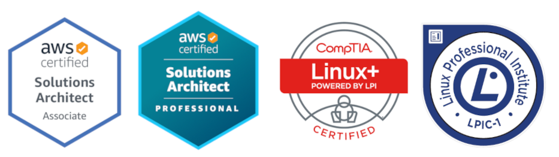


Olá, eu sou **Sidnei Weber** :wave:  
DevOps · SRE · Software livre · Linux · Cloud


Formado em Segurança da Informação, apaixonado por software livre, sempre buscando me aperfeiçoar e aprender novas tecnologias e tendências do mercado. Em busca de conhecimento (como diria o ET Bilu).

Quer ver minha trajetória profissional completa? Dá uma olhada no [currículo](/curriculo/).

## No dia a dia


 AWS 
 Terraform 
 Ansible 
 Docker 
 Python 
 Shell Script 


## Conhecimentos técnicos

  

    <h3>Cloud & IaC</h3>
    <ul><li>AWS</li><li>Google Cloud</li><li>Terraform</li><li>Ansible</li><li>Rundeck</li></ul>
  

  

    <h3>Containers & virtualização</h3>
    <ul><li>Docker</li><li>Proxmox</li><li>VMware</li><li>VirtualBox</li></ul>
  

  

    <h3>Linguagens</h3>
    <ul><li>Python</li><li>Shell Script</li><li>PHP</li><li>Node.js</li></ul>
  

  

    <h3>Redes & segurança</h3>
    <ul><li>Redes TCP/IP</li><li>Hardening de servidores Linux</li><li>iptables, pfSense, Fortinet</li><li>Nmap</li></ul>
  

  

    <h3>Servidores & serviços</h3>
    <ul><li>Apache</li><li>Squid, DHCP</li><li>LDAP / Samba</li><li>SSH / FTP</li><li>CUPS, Openfire</li></ul>
  

  

    <h3>Dados & monitoramento</h3>
    <ul><li>MySQL</li><li>PostgreSQL</li><li>Nagios</li><li>Zabbix</li></ul>
  

  

    <h3>Sistemas & ferramentas</h3>
    <ul><li>Linux</li><li>Windows</li><li>Git</li><li>WordPress, Magento</li></ul>
  

## Certificações

- AWS Certified Solutions Architect – Associate
- AWS Certified Solutions Architect – Professional
- CompTIA Linux+ (powered by LPI)
- LPIC-1 – Linux Professional Institute

## Formação



Curso concluído em 2022.


